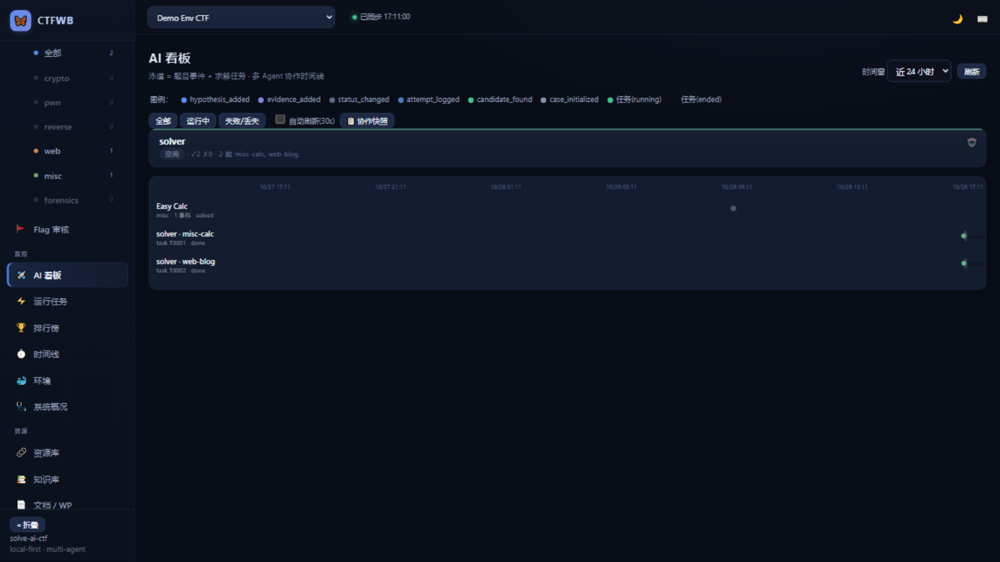
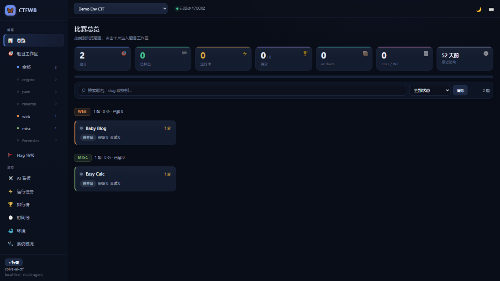
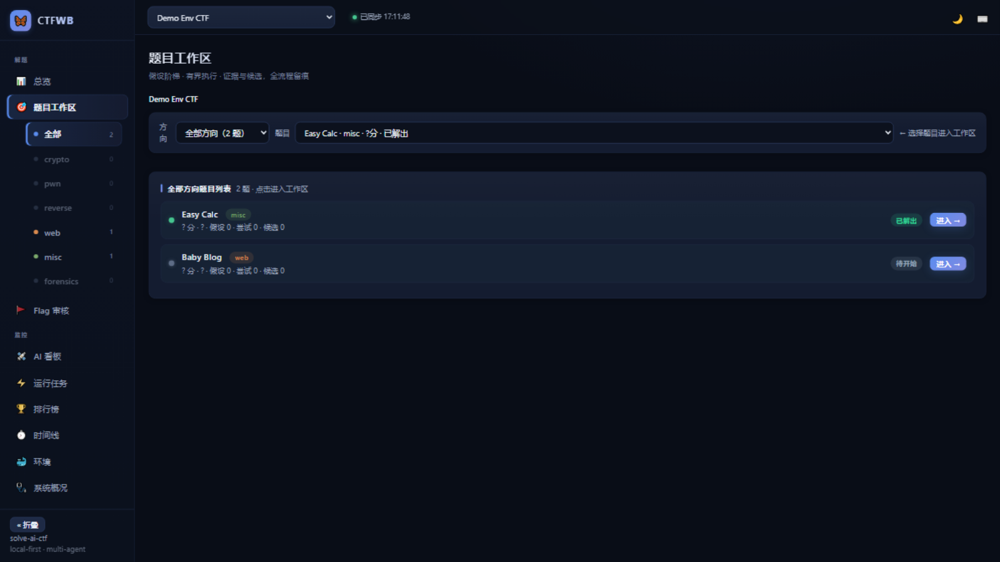
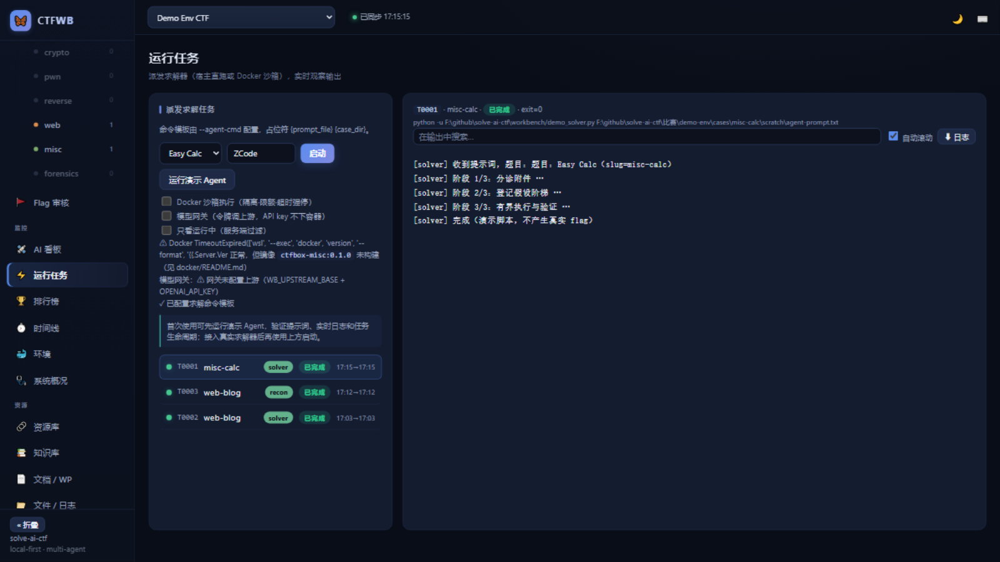
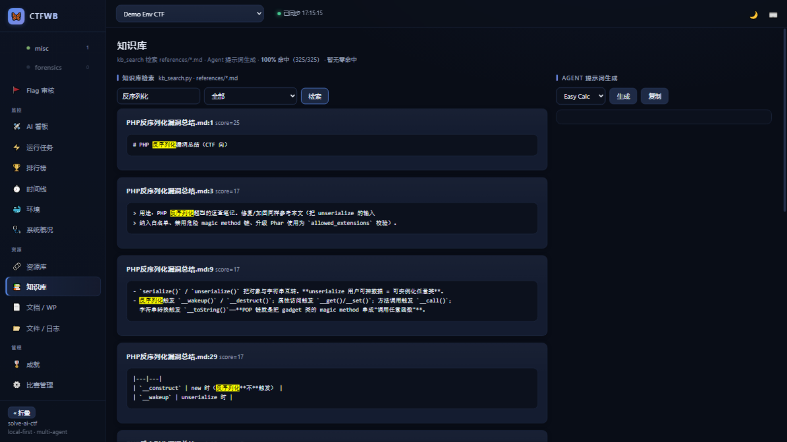
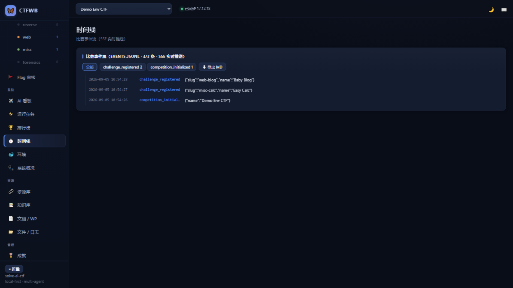
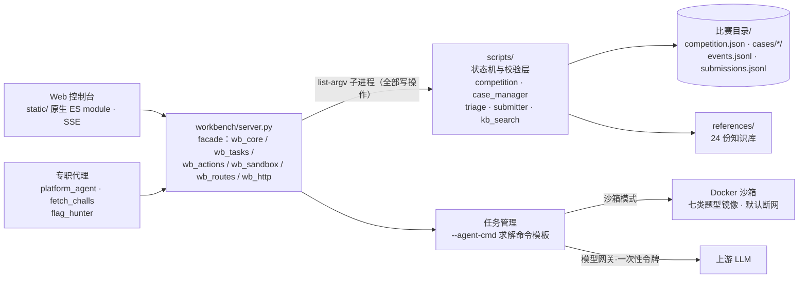

# Solve-AI-CTF


AI 驱动的 CTF 解题工作台：**分诊 → 假设 → 有界执行 → 验证 → 提交 → 复盘** 全流程留痕。
本地 Web 控制台 + Docker 沙箱执行 + Flag 自动识别与抢一血式自动提交 + 多 Agent 协作接口，
纯 Python 标准库实现，零 pip 依赖，可离线运行。

> 仅用于**已授权**的 CTF 比赛、靶场与安全研究。请勿用于未授权目标。



## ✨ 特性

- **确定性工具链**（纯标准库，零 pip 依赖，可离线）：比赛/题目/case 状态机、附件静态分诊、
  flag 扫描校验、提交器（平台适配器 + 限速 + 去重）
- **本地 Web 工作台**（`workbench/`，原生 ES module + vendored petite-vue，无构建）：
  题目看板、方向导航、假设阶梯/尝试/证据工作区、Flag 审核流水线、文件浏览、文档/WP
- **AI 协作看板**：多 Agent 泳道时间线（题目事件 + 求解任务同轴）、Agent 态势卡
  （运行/完成/失败计数、覆盖题数）、协作快照一键把当前态势转 Markdown 发给其他 AI
- **SSE 实时事件总线**：看板/总览在题目新增、状态变更、尝试与候选登记时即时刷新，免轮询
- **开赛自动化代理**：自动对接平台（`adapter: ctfd/buuctf` + 探测写提交配置）、自动抓题批量注册 +
  附件自动下载进 case artifacts（sha256 登记）、平台已解状态对账、Flag 猎手（自主扫描校验 →
  按置信分层抢一血式自动提交）
- **Docker 沙箱执行**：按题目类别自动选镜像（misc/crypto/pwn/web/reverse/forensics/ai 七类题型层），
  `--cap-drop ALL` + 资源三限 + 默认断网 + 超时看门狗强停 + 并发上限保护；WSL docker 自动回退
- **比赛级环境**：四层镜像矩阵（底座/题型/比赛/题目），声明式 env spec 定制 glibc、服务栈、比赛工具；
  web 题可拉起 compose 本地复现（服务与求解任务同生共死）
- **模型网关**：容器内 AI 求解器经一次性任务令牌调用上游模型，真实 API key 不下容器，按任务记账
- **复盘沉淀**：`competition.report` 导出 Markdown 复盘报告（真实 flag 自动脱敏）；时间线事件流
  按当前过滤导出 Markdown；知识库命中率统计反哺补洞
- **多 Agent 协作**：局域网/Tailscale 共享（`--host 0.0.0.0 --token`），`GET /api/help` 即完整协作 API
- **知识库**：24 份 references——4 份题型 Playbook + 分诊路由/案例语料/评测 + 15 份专项弹药库；
  中文检索优化（CJK 滑窗子词，命中率 100%）+ 命中词高亮 + `KB_EXTERNAL_DIR` 运行时接入外部库

## 📸 界面预览

| 比赛总览 | 题目工作区 |
|---|---|
|  |  |

| 运行任务（实时日志） | 知识库检索（命中高亮） |
|---|---|
|  |  |

| 事件时间线 | |
|---|---|
|  | *还有 Flag 审核 / 排行榜 / 环境 / 系统概况 / 成就 / 文档等 15+ 页面，启动后逐页探索。* |

## 🚀 快速开始

零依赖（Python ≥ 3.11，纯标准库），克隆即用：

```bash
git clone https://github.com/LceAn/solve-ai-ctf.git
cd solve-ai-ctf

# 一键启动本地工作台（浏览器打开 http://127.0.0.1:8787，默认加载 demo-env 演示比赛）
python 启动工作台.py

# 常用启动参数（全部透传）：
python 启动工作台.py --competition "比赛/xxx"      # 指定比赛目录
python 启动工作台.py --agent-cmd "python -u {solver_dir}/your_solver.py {prompt_file}"
python 启动工作台.py --host 0.0.0.0 --token <TOKEN>  # 局域网/Tailscale 共享

# 首次体验任务链路：运行任务页 → 「运行演示 Agent」（无需 --agent-cmd）
```

### 开赛三步

```bash
# ① 对接平台（CTFd 系开箱即用；探测并写入提交配置）
python workbench/platform_agent.py 比赛/xxx

# ② 自动抓题批量注册（附件自动下载 + sha256 登记）
python workbench/fetch_challs.py 比赛/xxx

# ③ 工作台页面派发求解任务（可勾选 Docker 沙箱 / 模型网关）

# Flag 猎手：自动扫描全部 case → 校验 → 按置信分层自动提交抢一血
python workbench/flag_hunter.py 比赛/xxx
```

平台令牌只放环境变量（如 `CTF_TOKEN`），绝不写入文件。

<details>
<summary><b>BUUCTF（buuoj.cn）开箱即用</b></summary>

```bash
export CTF_CREDENTIALS_JSON='{"username": "你的账号", "password": "你的密码"}'
python 启动工作台.py
# 比赛管理 → 开赛自动化 → 「套用预设并自动对接」→「派发抓题代理」
```

预设含表单登录（nonce CSRF）与会话拉题，全站 1900+ 题可自动注册。

</details>

### Docker 沙箱

```bash
cd workbench/docker
docker build -f base/Dockerfile -t ctfbox-base:0.1.0 .
docker build -f misc/Dockerfile -t ctfbox-misc:0.1.0 .
# 其余题型层按需构建，见 docker/README.md
```

比赛/题目级环境（推荐）：`competition.py init` 创建 `env/` 骨架，声明式 spec 后
`env_builder.py preheat / build / verify / status` 一键管理；派发时按
「case env.image → 题目层 → 比赛层 → 题型层」自动选镜像。字段说明见
[workbench/docker/COMPETITION_ENV_DESIGN.md](workbench/docker/COMPETITION_ENV_DESIGN.md)。

## 🤖 多 Agent 协作

- `GET /api/help` 即完整协作 API 文档（其他 AI/Agent 据此接手打题）
- [SKILL.md](SKILL.md) 是求解 Agent 的行为契约：红线、阶段流程、报告规范
- AI 看板「协作快照」按钮把当前态势转 Markdown 进剪贴板，直接粘给其他 AI 即可接续

## 🏗️ 架构



所有写操作都经脚本层校验后落盘——Web UI 不重写任何状态机逻辑，多 Agent 并发也不绕过审计。

## 🔒 安全设计

- 未知附件只做静态分诊，绝不直接执行
- 沙箱：cap-drop ALL、no-new-privileges、内存/CPU/Pids 三限、默认断网、超时强停
- **提交**：默认 dry-run，`--live` 需显式确认；滑动窗口限速 + flag 哈希去重。
  **例外**：Flag 猎手是显式启动的抢一血通道，`--autosubmit-config` 缺省开启自动 live，
  由 max_live 限流 + 正则校验 + dry-run 预检三重保护
- 凭证只存环境变量；模型网关一次性令牌，上游 key 不下容器
- 共享模式强制 `--token` 鉴权；前端 CSP 自检（禁 eval）与 eslint 质量门进 CI

## 📚 知识库

`references/` 内置 24 份 Markdown，`kb_search.py` 提供三种检索：

```bash
python scripts/kb_search.py search "宽字节注入" --category web    # 按方向检索
python scripts/kb_search.py resources "JWT" --kind reference      # 资源库
```

工作台「知识库」页对应 `search`（支持命中词高亮与命中率统计），「资源库」页对应 `resources`。

<details>
<summary><b>接入外部知识库（可选）</b></summary>

`references/` 只收录版权清晰的素材。体量更大、版权状态不一的第三方 WP 合集不随仓库分发，
改为**运行时挂载**：

1. 本地 clone 上游知识库（如 [Dest1ny-Sec/Des-CTF-Knowledge](https://github.com/Dest1ny-Sec/Des-CTF-Knowledge)）
2. 设环境变量 `KB_EXTERNAL_DIR=<克隆路径>`（PowerShell：`$env:KB_EXTERNAL_DIR="D:\kb\Des-CTF-Knowledge"`）
3. 重启 `python 启动工作台.py`
4. 工作台「资源库」页切到「📚 外部库」tab 检索

扫描有上限保护（单次 200 个文件、单文件 5000 行、跳过 `*.idx.md`），未配置该变量时该 tab 优雅返回空。
素材来源与许可见 [references/KB-ATTRIBUTION.md](references/KB-ATTRIBUTION.md)。

</details>

## 🧪 测试

```bash
python workbench/test_workbench.py   # 端到端断言（含 mock 平台/令牌/代理；数量以运行输出末尾为准）
python scripts/self_test.py          # 工具链自检
cd workbench && npx eslint static/   # 前端质量门（vendor 忽略）
```

沙箱/构建相关用例在「Docker 可用且所需镜像已构建」时真实执行，否则自动跳过（CI 即如此）。
CI 在 push/PR 时跑 compileall + 两套测试 + eslint（Ubuntu × Python 3.11/3.12）。

## 🗺️ 文档

- [CHANGELOG.md](CHANGELOG.md) — 更新日志（当前 v0.3.0）
- [SKILL.md](SKILL.md) — 求解 Agent 行为契约（红线、阶段流程、报告规范）
- [docs/](docs/) — 历史规划归档：ROADMAP、迭代账本、优化提案与收尾盘点
- [workbench/README.md](workbench/README.md) — 工作台启动参数与页签说明
- [workbench/docker/](workbench/docker/) — 沙箱镜像分层与安全模型

## 致谢

[Docker 镜像分层与安全模型](workbench/docker/) 参考了 [CTF-BTFly](https://github.com/huihuilikaile/CTF-BTFly)（MIT License）的设计，并在其留白处（默认断网、任务超时）做了加强。

## License

[MIT](LICENSE)
